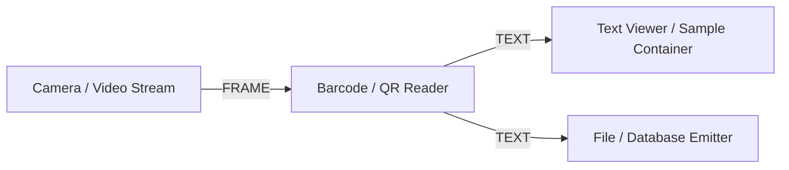

# Barcode & QR Code Reader Module

The **Barcode / QR Reader** module processes real-time image streams to detect and decode standard 1D barcodes and 2D QR codes. Decoded content is displayed in the module interface and dispatched to connected downstream nodes.

---

## Technical Specifications

- **Accepted Inputs**: `Frame` (Type: `FRAME`, supports 8-bit RGB/BGR, grayscale, and 12/16-bit monochrome).
- **Outputs**: `Decoded Text` (Type: `TEXT`, emits UTF-8 decoded string).
- **Engines Supported**:
  - `pyzbar` (primary high-speed decoding engine for barcodes and QR codes).
  - `cv2.QRCodeDetector` / `cv2.barcode.BarcodeDetector` (built-in OpenCV fallback when `pyzbar` is not present).

---

## Key Features & Controls

- **Automatic Format Normalization**: Automatically converts 16-bit or multichannel inputs into single-channel 8-bit grayscale for optimal decoding performance.
- **Change Detection**: Only emits output signals upon detecting a new or changed code, avoiding spamming downstream nodes.
- **Status Feedback**: Live indicators displaying detection states ("Waiting for frames...", "Code Detected!", or "No code found.").
- **Readonly Display**: Multiline text area allowing quick inspection and manual text copy.

---

## Integration Example

