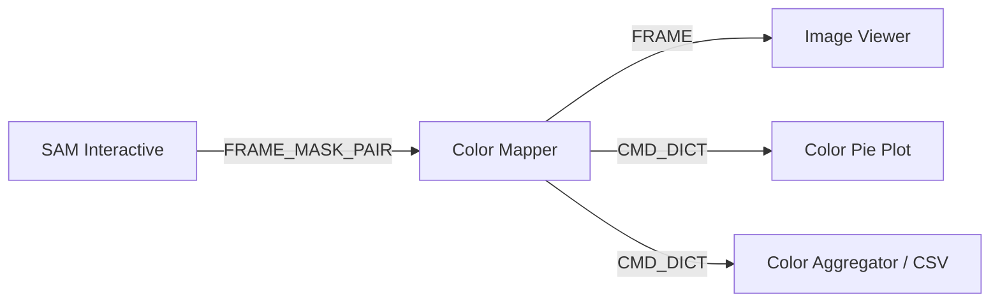

# Color Mapper Module

The **Color Mapper** module classifies pixels within masked or full-frame regions by mapping their Euclidean/CIE-Lab distances against a custom reference color palette. It features an interactive palette calibration editor, ROI color inspection, and real-time distribution statistics output.

---

## Technical Specifications

- **Accepted Inputs**:
  - `In` (Type: `FRAME`, raw camera frame).
  - `In` (Type: `FRAME_MASK_PAIR`, synchronized frame and segmentation mask).
  - `In` (Type: `FOLDER_PATH`, destination export directory).
  - `In` (Type: `CMD_DICT` / `TEXT`, sample labeling and workflow control commands).
- **Outputs**:
  - `Mapped Frame` (Type: `FRAME`, quantized image colorized with palette values).
  - `Distribution` (Type: `CMD_DICT`, percentage breakdown across palette classes).
  - `CMD` (Type: `CMD_DICT`, synchronization triggers for upstream segmentation nodes).

---

## Key Features & Controls

- **Interactive Palette Editor**:
  - Add, rename, and delete color classes.
  - Interactive color picker pastilles for fine-tuning RGB centroids.
  - Interactive Calibration Wizard: Prompts the user to `CTRL+Click` on targets in the image to calibrate reference colors.
- **ROI Probing & Inspection**:
  - Dynamic overlay showing mean RGB and closest matched palette class under mouse cursor.
  - Real-Time Distribution (`RT Out`): Continuously forwards local ROI proportions to connected pie/bar plotters.
- **Image Export & Cropping**:
  - Computes minimal bounding boxes around the mask.
  - Saves cropped transparent RGBA versions (`_RAW.png` and `_processed.png`) into the specified project folder.
- **Compare Mode**: Hold `Compare` to preview the original frame.

---

## Pipeline Integration

