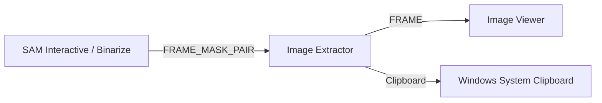

# Image Extractor Module

The **Image Extractor** module receives synchronized `(Frame, Mask)` pairs, isolates the segmented area, sets non-masked background pixels to fully transparent alpha (`0`), and transfers the resulting RGBA image directly to the Windows clipboard for instant pasting into presentation software or document editors.

---

## Technical Specifications

- **Accepted Inputs**: `In` (Type: `FRAME_MASK_PAIR`, receives `(np.ndarray, np.ndarray)`).
- **Outputs**: `Extracted RGBA` (Type: `FRAME`, emits 4-channel uint8 RGBA array with transparent background).
- **Clipboard Formats**: Windows native `PNG` clipboard format (preserves alpha transparency) and standard `CF_DIB` (white background fallback).

---

## Key Features & Controls

- **Automatic Format Matching**: Automatically reconciles dimensions if mask dimensions differ from frame dimensions via nearest-neighbor scaling.
- **Auto-Copy to Clipboard**: When enabled, every newly computed segmented image is asynchronously transferred to the clipboard without stuttering the GUI.
- **Manual Copy**: Provides a button to trigger immediate clipboard export on the currently held preview.
- **Embedded Viewer**: High-performance DearPyGui texture plot displaying live extraction feedback.

---

## Pipeline Integration

