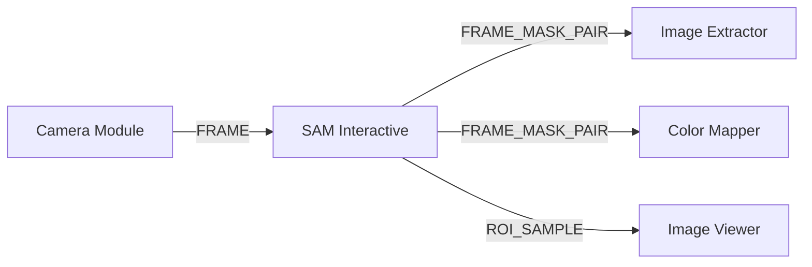

# SAM Interactive Module

The **SAM Interactive** module wraps Meta's Segment Anything Model (SAM) with an interactive DearPyGui point-prompt interface. Users segment complex structures with positive/negative clicks and forward high-precision masks downstream.

---

## Technical Specifications

- **Accepted Inputs**: `In` (Type: `FRAME`, `FRAME12`, `FRAME16`, `CMD_DICT` for remote resetting).
- **Outputs**:
  - `Overlay` (Type: `FRAME`, composite visual preview with colored segment overlay).
  - `Mask` (Type: `FRAME`, binary single-channel mask).
  - `ROI` (Type: `ROI_SAMPLE`, bounding box sample with embedded mask).
  - `Result` (Type: `FRAME_MASK_PAIR`, synchronized `(frame, mask)` tuple).
- **Hardware Acceleration**: Automatic CUDA / GPU acceleration with PyTorch when NVIDIA drivers are present, fallback to CPU execution.

---

## Key Features & Controls

- **Interactive Point Prompts**:
  - `CTRL + Left Click`: Adds positive (foreground) prompt green point.
  - `CTRL + Right Click`: Adds negative (background) prompt red point.
- **Image Pre-processing**:
  - `Enable Proc.`: Toggles pre-processing enhancement before feeding the frame into the SAM image encoder.
  - `Sat`: Color saturation multiplier (0.0 to 5.0).
  - `Gamma`: Gamma correction power factor (0.1 to 5.0) to reveal low-contrast boundaries.
- **Instant Reset**:
  - `Reset Points` button or `CMD_DICT` signal (`{"clear": True}`) purges current prompts and resets the segmentation mask.

---

## Pipeline Integration

