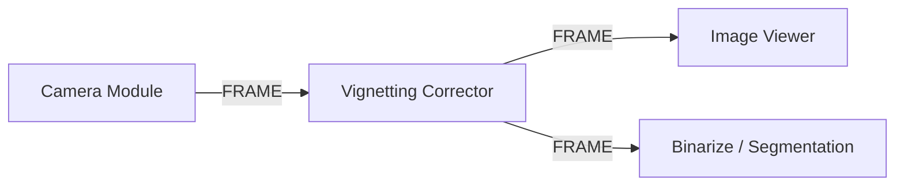

# Vignetting Corrector Module

The **Vignetting Corrector** module rectifies radial lens illumination falloff and optical shading artifacts by applying flat-field calibration matrices.

---

## Technical Specifications

- **Accepted Inputs**:
  - `In` (Type: `FRAME`, supports 8-bit, 12-bit, and 16-bit monochrome/color images).
  - `In` (Type: `FILE_PATH`, file path string to dynamically load calibration image).
- **Outputs**: `Frame` (Type: `FRAME`, flat-field corrected image).
- **Bit Depths Supported**: 8-bit (uint8), 12-bit (uint16 scaled), and 16-bit (uint16 native).

---

## Key Features & Controls

- **Flat-Field Calibration**: Ingests reference white/gray images, generates normalized inverse gain matrices, and applies pixelwise multiplication.
- **Bit Depth Selection**: Selectable bit depth presets (`8-bit`, `12-bit`, `16-bit`) adapting multiplication normalization to camera sensor ADC dynamics.
- **Compare Mode**: Interactive hold button (`COMPARE (Hold)`) to immediately view the raw uncorrected frame for real-time before/after assessment.
- **Matrix Preview**: Dispatches the computed gain map directly to downstream viewers to diagnose lens shading profiles.

---

## Pipeline Integration

